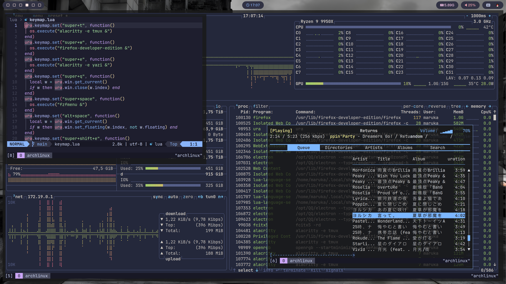

# Ura


**Ura** is a brand-new Wayland compositor built on **wlroots**, written in **C++**, and uses **Lua (LuaJIT)** as its configuration system.

The strength of Ura lies in its high customizability. Through a **hook mechanism**, it exposes part of the window manager’s functionality, allowing you to inject code into specific workflows.

Lua is a general-purpose language supported by many editors and LSPs (like `lua_ls`). This enables features such as error checking, syntax highlighting, and auto-completion for configuration files, allowing you to configure the compositor as if you're writing actual code.




## Installation

### Build

Dependencies include:

- wlroots0.20
- [luajit](http://luajit.org/)
- [libnotify](https://gitlab.gnome.org/GNOME/libnotify)
- [spdlog](https://github.com/gabime/spdlog)
- [EnTT](https://github.com/skypjack/entt) (auto-imported by CPM)
- raylib (only `rlgl.h` is required; the raylib window/2D modules are not initialized)
- EGL, OpenGL ES 2.0, GBM and libdrm

Make dependencies include:

- wayland-protocols
- [sol2](https://aur.archlinux.org/packages/sol2) (auto-imported by CPM)
- cargo
- make
- cmake
- pkgconf
- [Glaze](https://github.com/stephenberry/glaze)
- cxxopts
- ninja (optional)
- sccache (optional)

```shell
git clone https://github.com/levinion/ura.git
cd ura
make
```

Run the C++ and tool tests with:

```shell
ctest --test-dir build --output-on-failure
```

### Docker

```shell
docker build -t levinion/ura .
docker run --rm -v .:/home/dev/ura levinion/ura make build
sudo make install
```

### AUR

```shell
paru/yay -S ura-git
```

## Renderer backend

Ura ships its own wlroots renderer implementation, `ura_raylib_renderer_create()`.
It is a complete `wlr_renderer`: it owns the EGL context, imports SHM and
DMA-BUF buffers, creates render passes, manages buffer lifetimes and performs
explicit timeline synchronization. Ura no longer uses `wlr_scene` for
composition, damage tracking, hit testing, layer layout or output commits.

`wlr_renderer_autocreate()` is no longer used. If the raylib renderer cannot be
created, compositor startup fails instead of silently switching to wlroots'
renderer.

The implementation lives in [`src/render/raylib`](src/render/raylib):

- `renderer.cpp` — `wlr_renderer_impl`, format queries, timers and factory
- `render_pass.cpp` — `wlr_render_pass_impl`, clipping, transforms and explicit sync
- `texture.cpp` — SHM/DMA-BUF textures, updates and readback
- `egl.cpp` — GBM/surfaceless EGL context and extension loading
- `buffer.cpp` — DMA-BUF import, modifiers, multi-plane EGLImages and FBOs
- `shader.cpp` — GLES2 shader programs and direct quad submission
- `resources.cpp` — DRM/EGL format sets and pixel-format mapping
- `effects.cpp` — optional rlgl-based post-processing hook
- `rlgl_es.cpp` — an in-tree OpenGL ES 2.0 build of raylib's rlgl

The system raylib package is often built for desktop OpenGL 3.3, so Ura compiles
rlgl for ES 2.0 directly and never calls `InitWindow()` or creates a second
graphical context. EGL and OpenGL ES come from the system graphics stack
(Mesa/GBM or the vendor driver); there is no ANGLE, archlinuxcn or AUR
dependency.

The renderer implements wlroots 0.20's unstable renderer interfaces. DRM output
composition uses an EGL native fence as a render timeline and passes it to
`wlr_output_state_set_wait_timeline()`; `glFinish()` remains only as a fallback
for SHM readback or backends without timeline support. Keep the wlroots 0.20.x
headers and `src/render/raylib` in sync when upgrading wlroots.

If no DRM node is supplied by the backend, Ura opens a render node or uses a
surfaceless EGL context; `WLR_RENDER_DRM_DEVICE` can select a specific node.
`WLR_RENDERER` no longer has any effect on Ura's renderer selection.

An optional rlgl effect is available for validating the extra-draw path:

```shell
URA_RAYLIB_EFFECT_TINT='#RRGGBBAA' ura
```

The EnTT scene is now the authoritative scene model. Frame preparation is
split into explicit stages: a main-thread task discovery and immutable world
snapshot, parallel per-output frame planning, a main-thread enter/leave and
primary-output merge, and finally the GPU/output commit. Surface-tree snapshot
tasks are split per scene item, so a single output with multiple windows or a
bar can use the worker pool even without a second monitor. Worker threads only
read disjoint wlroots surface trees and the immutable snapshot; they never
mutate the ECS registry or wlroots. Single-output frame planning stays inline
to avoid thread overhead, while multi-output planning uses the same small
persistent worker pool.

The output path tracks scene and surface-commit damage, renders toplevel
borders as frame-plan rectangles, and commits through the raylib renderer.
Surface enter/leave, preferred scale, frame scheduling and render-completion
synchronization are handled by Ura itself.

To profile the frame stages, run with `URA_FRAME_PROFILE=1`. Ura logs a summary
every five seconds with world/plan/merge/render timings, full-redraw counts,
damage boxes and per-frame task/surface counts.

Direct scanout is enabled for eligible fullscreen, full-output layer and lock
surfaces. If a frame does not satisfy the scanout constraints, it falls back to
GPU composition automatically.

The renderer test exercises DMA-BUF output import, SHM texture upload, render
passes and readback. The frame renderer test covers full and partial-damage
output commits:

```shell
ctest --test-dir build -R ura-raylib-renderer --output-on-failure
```

## Configuration

Ura looks for its configuration in `$XDG_CONFIG_HOME/ura/init.lua` when `XDG_CONFIG_HOME` is set, or `$HOME/.config/ura/init.lua` otherwise. If that selected user path is missing, it falls back to `/etc/ura/init.lua`.

The [default configuration file](/assets/init.lua) is installed with Ura at `/etc/ura/init.lua`. If you wish to modify it, it's recommended to copy it to your user directory before making changes.

The default terminal is [foot](https://codeberg.org/dnkl/foot), which can be launched using the `super+t` shortcut. However, make sure that `foot` is installed before starting Ura, or change it to another terminal of your choice.

### Keybindings

Define keybindings using the following format: one or more modifier keys (or none) followed by a single key, connected by `"+"`:

```lua
ura.keymap.set({ "super+t" }, function()
  ura.api.spawn("foot")
end)

ura.keymap.set({ "super+q" }, function()
  ura.class.UraWindow:current():close()
end)

ura.keymap.set({ "alt+space" }, function()
  ura.class.UraWindow:current():toggle_layout("floating")
end)
```

### Hooks

Hooks are Ura’s most powerful feature. They allow arbitrary operations to be performed using public APIs during the compositor’s runtime, enabling features that other compositors typically can’t support. Hooks also offer a cleaner way to implement advanced features such as window rules.

Here are some examples:

The `prepare` hook runs after the Lua module is initialized, but before compositor resources are created. You can use this hook to set global environment variables:

```lua
ura.hook.add("prepare", function(_)
  ura.api.set_env("WLR_RENDER_DRM_DEVICE", "/dev/dri/renderD128")
  ura.api.set_env("WLR_NO_HARDWARE_CURSORS", "0")
  ura.api.set_env("LIBVA_DRIVER_NAME", "nvidia")
  ura.api.set_env("__GLX_VENDOR_LIBRARY_NAME", "nvidia")
end)
```

Use the `ready` hook to start applications after the compositor backend is running:

```lua
ura.hook.add("ready", function(_)
  ura.api.set_env("DISPLAY", ":0")
  ura.api.spawn("xwayland-satellite")
end)
```

The `window-new` hook runs when a new top-level window is prepared, before its first map. You can use it to apply window-specific styling:

```lua
ura.hook.add("window-new", function(e)
	local win = ura.class.UraWindow:new(e.id)
	local app_id = win:app_id()
	assert(app_id)
	if app_id == "fzfmenu" then
		win:set_layout("floating")
		win:resize(1000, 600)
		win:center()
	end
end)
```

For the complete Lua-side API, see the [Lua API reference](docs/lua-api.md), including the [hook names and event payloads](docs/lua-api/hooks.md).

More configuration examples are available at: [my dotfiles](https://github.com/levinion/dotfiles/tree/main/linux/user/ura/.config/ura)

## Dev

```shell
docker build -t levinion/ura .
docker run --rm -it -v .:/home/dev/ura levinion/ura
```

## License

This project is licensed under the terms of the [GPLv3](/LICENSE).
